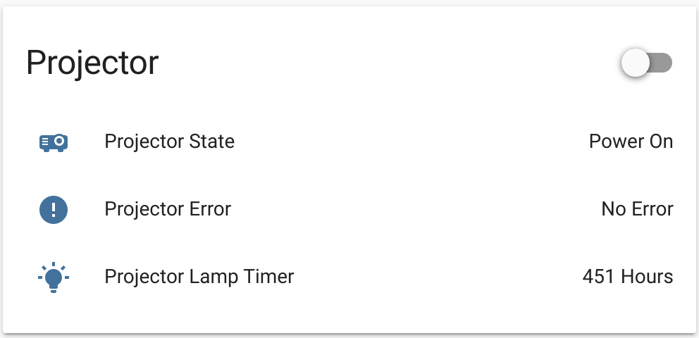
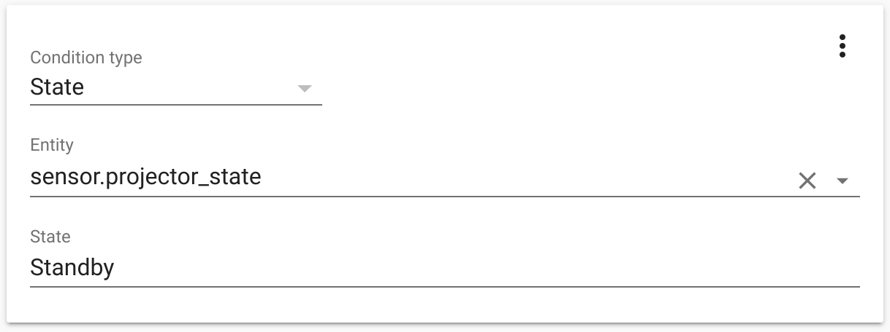
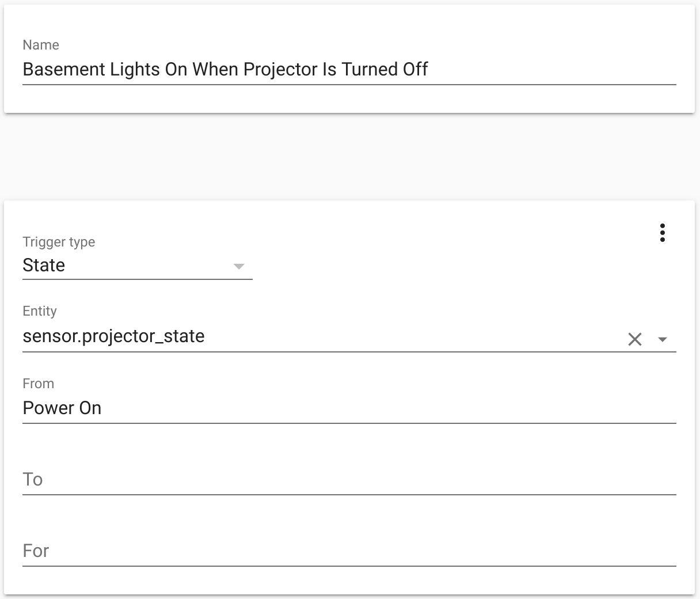
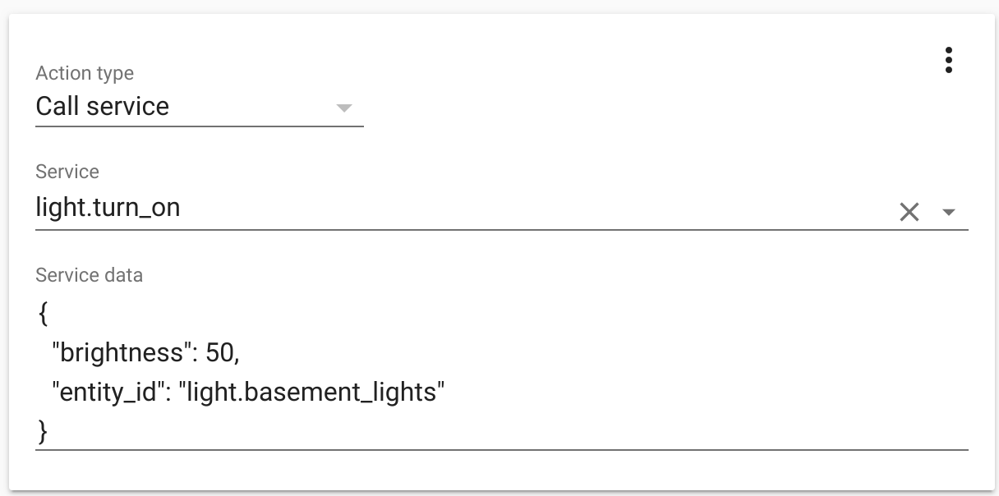

# Projector Status Pusher for HomeAssistant
This collection of scripts allows for hardware (a RaspberryPi, for example) connected to a projector to push the projector's status to HomeAssistant.

A sample hardware configuration would be a RaspberryPi with a usb->serial adapter connected to the RS232 port of a projector.
The user would then clone this repo, create a configuration based on [the sample config](config/sample.json), replacing the necessary values, and running [install.sh](install.sh) (passing the created configuration file as an argument).

## Optoma: continuous listener + webhook
The Optoma driver ([projectors/optoma.py](projectors/optoma.py), Python 3.5+, standard library only) keeps the serial port
open and reports every state the projector announces, instead of polling once every few seconds:

| State | Source |
|---|---|
| `Warming Up` | projector sends `INFO1` (about 7 s after power-on) |
| `Power On` | polled `~00150 1` reply reports power `1` (polled every 2 s while warming up) |
| `Cooling Down` | projector sends `INFO2` (immediately at power-off) |
| `Standby` | projector sends `INFO0` (about 17 s later), or polled power `0` |

`P`/`F` replies and stray bytes are ignored. `INFO3` ("signal out of range") and any other `INFO` code are reported in the
error field until the next state change (the projector sends no "cleared" message). Lamp hours come from the same poll (every 30 s outside warm-up).

It pushes `{"state", "error", "lamp_hours"}` to a Home Assistant **webhook** on every change and every 5 minutes.
No access token is needed, and the sensors are real entities that survive Home Assistant restarts.
Config: `port`, `projector: "optoma"`, `webhook_url` (optional `projector_id`, default `00`).

Home Assistant side (`configuration.yaml`, then restart):
```yaml
template:
  - trigger:
      - trigger: webhook
        webhook_id: <long-random-id>      # the last part of webhook_url
        local_only: true
        allowed_methods: [POST]
    sensor:
      - name: Projector State
        unique_id: projector_state
        state: "{{ trigger.json.state }}"
        icon: mdi:projector
      - name: Projector Error
        unique_id: projector_error
        state: "{{ trigger.json.error }}"
        icon: mdi:alert-circle
      - name: Projector Lamp Timer
        unique_id: projector_lamp_timer
        state: "{{ trigger.json.lamp_hours }}"
        unit_of_measurement: h
        icon: mdi:lightbulb-on
```
Migrating from the old `/api/states` push: stop the old service and restart Home Assistant **before** adding the template,
so the old pushed `sensor.projector_state` is gone and the new entity gets that ID (not `sensor.projector_state_2`).
Then revoke the old long-lived token.

The Sony driver still uses the original polling loop and `/api/states` push (`api_token`, `ha_base_url`).

The resulting card will be created in HomeAssistant:



## HomeAssistant Automation
The user can create automations based on the states within the Projector card.  For instance, unless the Projector is in `Standby`, the user can prevent Presence Sensors from turning the lights on with a Condition:



Also, if the Projector goes from `Power On` to any other state, the user can turn the lights on dimmed:


